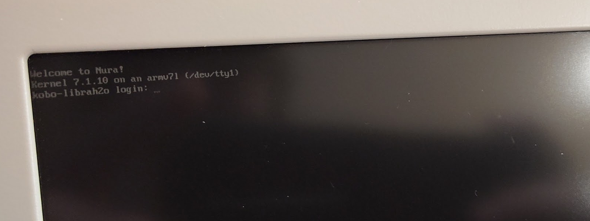

# Kobo Libra H2O — Nura Linux Display Drivers



*The Libra H2O running Nura Linux with the EPDC framebuffer console working — “Welcome to Nura!” / “Kernel 7.1.10 on an armv7l”.*

Working EPDC/e-paper display support for the **Kobo Libra H2O (N873)** under
**Nura Linux** (postmarketOS/Alpine, mainline i.MX DRM).

This repository contains the two kernel patches, the device-tree fragment,
prebuilt artefacts for the tested kernel, and the packaging notes needed to
reproduce the working display.

> **Status:** display works.  The panel clears fully on boot, text and
> grayscale images render in the correct position and shade, there is no
> vertical banding, and full-screen image updates use a proper GC16 refresh.
> The console/UI path keeps fast partial updates.

---

## 1. Hardware and software context

| Item | Value |
|---|---|
| Device | Kobo Libra H2O, model **N873** |
| SoC | NXP i.MX6SLL |
| Panel | **ED070KH1** / E70K02, 1264 x 1680 e-paper |
| Display controller | i.MX EPDC at `0x020f4000` |
| PMIC | SY7636A (EPDC rails/VCOM), I2C address `0x62` |
| OS | Nura Linux / postmarketOS, Alpine userspace |
| Kernel | `linux-postmarketos-imx-ereader` **7.1.10** |
| DRM driver | Andreas Kemnade's `mxc-epdc` branch, commit `8c68d420f2a30cfdd6673d971e8ae325e9835fe6` |

The stock Kobo software uses a vendor fbdev driver.  Nura uses the mainline
DRM driver (`mxc_epdc`), which is a different implementation with different
device-tree requirements and a different update model.

### Unit-specific discovery: the NTX hardware config

The retail unit stores an NTX hardware-config block in the eMMC at physical
offset **`0x80000`** (512 KiB), magic `"HW CONFIG v3.1"`.  The relevant fields
for this panel are:

```
bDisplayResolution = 15      # 1264 x 1680
bDisplayBusWidth   = 1       # 16-bit SDDO source-driver bus
VCOM_10mV          = 0xff4e  # -1.78 V
```

That `bDisplayBusWidth = 1` is the key discovery.  The mainline driver
assumed an 8-bit bus.

The stock DTB (`mx6sll-E70K00.dtb`) and the vendor kernel's
`drivers/video/fbdev/mxc/mxc_epdc_v2_fb.c` were used as reference.  The vendor
driver selects the EPDC bus width from `bDisplayBusWidth`; mainline did not.

---

## 2. What was wrong

There were three independent issues.

### 2.1 SDDO bus width: 8-bit vs 16-bit

The EPDC talks to the panel's source drivers over the **SDDO** bus.  On this
panel the bus is 16 bits wide, and the EPDC must shift **8 pixels per SDCLK**.
Mainline hard-coded 8-bit / 4 pixels per SDCLK in `epdc_hw.c`:

```c
reg_val = ... | EPDC_TCE_CTRL_PIXELS_PER_SDCLK_4;
```

With the wrong bus geometry the image is horizontally corrupted, vertical
black bands appear, and a full-screen erase never completes.  This was the
main cause of the "vertical banding + stale image" failure.

The required `EPDC_TCE_CTRL` bits are:

```
EPDC_TCE_CTRL_SDDO_WIDTH_16BIT    = 0x4
EPDC_TCE_CTRL_PIXELS_PER_SDCLK_4  = 0x2
EPDC_TCE_CTRL_PIXELS_PER_SDCLK_8  = 0x3
```

so the 16-bit configuration uses `0x4 | 0x3 = 0x7`.

### 2.2 Pixel clock: 127.06 MHz instead of 135 MHz

The vendor timing table uses the 540 MHz EPDC branch.  The mainline clock tree
left `pll3_pfd2` at 508.235294 MHz; with the `/4` divider `epdc_pix` became
127.058824 MHz.  That stretches the image horizontally by about 6 %.

The DTS now pins:

```
pll3_pfd2 = 540 MHz
epdc_pix  = 135 MHz   (540 / 4)
```

matching the vendor timing.

### 2.3 Full-screen changes were submitted as partial updates

The DRM/fbdev damage path submits every update as:

```
waveform_mode = WAVEFORM_MODE_AUTO   (257)
update_mode   = UPDATE_MODE_PARTIAL  (0)
```

Small console/cursor clips are fine with that.  A full-screen image change is
not: the panel needs a proper full refresh with the **GC16** waveform
(`mode_gc16 = 2`) and `UPDATE_MODE_FULL` (1).  Without it, the framebuffer
write could complete but the panel silently kept showing the old console
image.

The fix makes the choice depend on the clip:

- clip covers the whole framebuffer -> `mode_gc16` + `UPDATE_MODE_FULL`;
- any smaller clip -> `WAVEFORM_MODE_AUTO` + `UPDATE_MODE_PARTIAL`.

This keeps console updates fast and makes image viewers/screen clears correct.

---

## 3. What the driver does

The mainline EPDC stack is split into several files under
`drivers/gpu/drm/mxc-epdc/`:

| File | Responsibility |
|---|---|
| `mxc_epdc_drv.c` | platform probe, DT parsing, clocks, regulators, pinctrl, DRM device creation |
| `epdc_hw.c` | programs EPDC timing, TCE/source-driver configuration, GPIOs and power sequencing |
| `epdc_update.c` | converts the DRM framebuffer to EPDC grayscale, builds update descriptors, merges/collides updates, queues the update work |
| `epdc_waveform.c` | loads/validates the panel waveform firmware and prepares waveform-mode numbers (INIT, DU, GC16, ...) |
| `epdc_regs.h` | EPDC register and bit definitions |
| `mxc_epdc_drm.c` / DRM helpers | CRTC/plane/connector and fbdev integration |

A simplified pipeline:

1. A DRM atomic commit (or fbdev damage) produces a damaged rectangle.
2. `epdc_update.c` walks the RGB framebuffer and converts each pixel to the
   EPDC 5-bit grayscale format using a BT.601-weighted conversion
   (`epdc_from_rgb_*`).
3. An update descriptor is queued with `waveform_mode`, `update_mode`,
   temperature and the update rectangle.
4. `epdc_waveform.c` has already loaded the panel's `.fw` waveform blob and
   mapped the mode names used by the vendor (INIT, DU, GC16, ...).
5. The EPDC drives the source/gate drivers with the selected waveform.  The
   source-driver bus width and pixels-per-SDCLK come from `EPDC_TCE_CTRL` in
   `epdc_hw.c`.
6. The panel physically moves the e-paper particles; the image remains after
   power is removed.

The important point for this port: the **image data path was already working**;
the display looked broken because the source-driver bus geometry and the
full-refresh waveform choice were wrong.

### Waveform and VCOM

The waveform file used by the device is the stock ED070KH1 waveform
(`epdc-waveform-ED070KH1.fw` in the main project).  The driver loads it and
uses the vendor mode numbers.  VCOM is supplied by the SY7636A PMIC.  Mainline
reports about `1.25 V` while the NTX config says `-1.78 V`; the image is
currently correct, so VCOM calibration is left as an optional contrast /
ghosting refinement (see Limitations).

---

## 4. Changes in this repository

### `patches/0002-mxc-epdc-sddo-width.patch`

Adds an optional device-tree property and uses it in the driver:

```dts
sddo-width = <16>;
```

- `mxc_epdc.h`: new `sddo_width` field in the EPDC mode struct.
- `mxc_epdc_drv.c`: reads `sddo-width`; defaults to `0` (legacy 8-bit path).
- `epdc_hw.c`:
  - `16` -> `SDDO_WIDTH_16BIT | PIXELS_PER_SDCLK_8` (`0x7`);
  - otherwise -> `PIXELS_PER_SDCLK_4` (`0x2`), preserving existing panels.
- `fsl,mxc-epdc.yaml`: documents the new property (`8` or `16`).

### `patches/0003-mxc-epdc-fullscreen-gc16.patch`

In `mxc_epdc_send_single_update()`:

```c
if (clip->x1 == 0 && clip->y1 == 0 &&
    clip->x2 == priv->epdc_mem_width &&
    clip->y2 == priv->epdc_mem_height) {
        upd_desc->upd_data.waveform_mode = priv->wv_modes.mode_gc16;
        upd_desc->upd_data.update_mode = UPDATE_MODE_FULL;
} else {
        upd_desc->upd_data.waveform_mode = WAVEFORM_MODE_AUTO;
        upd_desc->upd_data.update_mode = UPDATE_MODE_PARTIAL;
}
```

This is deliberately conservative: only an exact full-screen clip is promoted
to a full GC16 refresh.  A future improvement could use an area/ghosting
heuristic or a userspace request flag.

### `dts/librah2o-epdc.dtsi`

Device-tree fragment for the Libra H2O:

- EPDC pinctrl group (data, SDCLK, SDLE, SDOE, SDSHR, SDCE0, GDCLK, GDOE,
  GDRL, GDSP);
- SY7636A/EPDC supplies;
- `assigned-clocks` for 540 MHz `pll3_pfd2` and 135 MHz `epdc_pix`;
- vendor 540 MHz timing:

```
1264 x 1680, 135 MHz
hback 28, hfront 204, hsync 72
vback 4, vfront 12, vsync 1
vscan-holdoff 4
sdoed-width 10, sdoed-delay 20
sdoez-width 10, sdoez-delay 20
gdclk-hp-offs 746, gdsp-offs 553
gdoe-offs 0, gdclk-offs 83
num-ce 1
```

- `sddo-width = <16>;`
- `status = "okay";`

The upstream `imx6sll-kobo-librah2o.dts` does not include an EPDC node; the
fragment is appended to that DTS before compilation.  The prebuilt DTB in
`dts/` is the resulting tested blob.

### Packaging

`packaging/APKBUILD` is the modified
`linux-postmarketos-imx-ereader` recipe.  Besides listing the two patches, it
contains:

```
INSTALL_MOD_STRIP="--remove-section=.BTF --remove-section=.BTF.ext --strip-debug"
```

The current `pahole`/clang in edge generates BTF that the 7.1.10 kernel rejects
with `failed to validate module BTF: -22`.  Stripping BTF during module install
makes the package loadable.  This is a workaround for the old kernel; if the
kernel is updated, the strip can be revisited.

---

## 5. Prebuilt artefacts

Tested against the exact kernel:

```
Linux kobo-librah2o 7.1.10 #1-postmarketOS ... armv7l
vermagic: 7.1.10 mod_unload modversions ARMv7 p2v8
```

| File | Notes |
|---|---|
| `prebuilt/mxc_epdc_drm-7.1.10.ko.zst` | final source-built module, no BTF, both patches compiled in |
| `dts/imx6sll-kobo-librah2o-epdc.dtb` | tested EPDC/clock DTB |
| `prebuilt/SHA256SUMS` | checksums |

The prebuilt module is **kernel-version-specific**.  If the kernel or config
changes, rebuild it; do not force-load a module with a different vermagic.

The prebuilt DTB corresponds to the tested timing and `sddo-width = <16>`.
Keep backups of the original `/boot` DTB before replacing it.

---

## 6. Building from source

The recommended path is to build the kernel package with the two patches, then
install only the module and the EPDC DTB on the device.

### 6.1 Apply the patches

Use the same kernel source as the package:

```sh
git clone https://github.com/akemnade/linux
cd linux
git checkout 8c68d420f2a30cfdd6673d971e8ae325e9835fe6

patch -p1 < /path/to/patches/0002-mxc-epdc-sddo-width.patch
patch -p1 < /path/to/patches/0003-mxc-epdc-fullscreen-gc16.patch
```

### 6.2 Build the module through pmaports

Copy `packaging/APKBUILD` and the two patches into the pmaports package
directory:

```
device/testing/linux-postmarketos-imx-ereader/
```

Then:

```sh
pmbootstrap build --arch armv7 linux-postmarketos-imx-ereader
```

The resulting APK is under `pmaports`/pmbootstrap packages.  Extract the module:

```
usr/lib/modules/7.1.10/kernel/drivers/gpu/drm/mxc-epdc/mxc_epdc_drm.ko.zst
```

The recipe strips `.BTF`/`.BTF.ext` during install; verify the resulting module
has no `.BTF` section if you change toolchain versions.

### 6.3 Build the DTB

The fragment is designed to be appended to the upstream
`arch/arm/boot/dts/nxp/imx/imx6sll-kobo-librah2o.dts`:

```dts
#include "librah2o-epdc.dtsi"
```

Compile with the kernel's `dtc` (or copy `dts/librah2o-epdc.dtsi` and use the
prebuilt DTB).  The tested DTB uses the clock and timing values listed above.

### 6.4 Install on the device

Back up the current files first:

```sh
M=/lib/modules/7.1.10/kernel/drivers/gpu/drm/mxc-epdc/mxc_epdc_drm.ko.zst
sudo cp -a "$M" "$M.before-new-display"
sudo cp -a /boot/imx6sll-kobo-librah2o.dtb \
           /boot/imx6sll-kobo-librah2o.dtb.before-new-display
```

Install and reboot:

```sh
sudo cp mxc_epdc_drm-7.1.10.ko.zst "$M"
sudo cp imx6sll-kobo-librah2o-epdc.dtb /boot/imx6sll-kobo-librah2o.dtb
sync
sudo reboot
```

### 6.5 Verify

```sh
ls -l /dev/fb0
lsmod | grep mxc_epdc
dmesg | grep -i -E 'mxc_epdc|Mode:|fb0'
```

Expected:

```
mxc_epdc 20f4000.epdc: EPDC pix format: 500
[drm] Initialized mxc_epdc 1.0.0 for 20f4000.epdc on minor 0
mxc_epdc 20f4000.epdc: Mode: 1264 x 1680
[drm] fb0: mxc_epdcdrmfb frame buffer device
```

No `BTF` validation error should appear.

### 6.6 Optional image test

With the console unbound:

```sh
sudo sh -c 'echo 0 > /sys/class/vtconsole/vtcon1/bind'
```

Write a 1264x1680 BGRX buffer to `/dev/fb0` and wait for the EPDC worker.  The
full-screen write should be promoted to GC16 + FULL and the image should stay
on the panel.  Rebind the console with:

```sh
sudo sh -c 'echo 1 > /sys/class/vtconsole/vtcon1/bind'
```

---

## 7. Evidence and validation

- The panel previously showed vertical black bands, a stale console image and
  failed to erase.  After the 16-bit SDDO fix it clears fully and shows normal
  text.
- `clk_summary` confirms `pll3_pfd2 = 540 MHz` and `epdc_pix = 135 MHz`.
- The full-screen image test rendered accurate grayscale after the GC16/FULL
  change; small console updates remained responsive.
- The final source-built module loads with vermagic
  `7.1.10 mod_unload modversions ARMv7 p2v8`.
- The packaged module initially failed BTF validation; with BTF stripped it
  loads and the display is correct.

More detailed bring-up notes and the binary-patch history are in
`docs/BUILD-AND-EVIDENCE.md`.

---

## 8. Limitations / possible next work

- **VCOM:** mainline reports about `1.25 V`; the NTX config says `-1.78 V`.
  The current image looks correct, but contrast/ghosting could be improved by
  teaching `sy7636a-regulator` to set VCOM, or by setting it through the
  vendor-compatible path.
- **DTB is separate:** the kernel package's own
  `imx6sll-kobo-librah2o.dtb` does not contain the EPDC node.  The working DTB
  is the custom asset installed separately.  Do not overwrite it during a
  kernel upgrade.
- **Full-refresh heuristic:** only an exact full-screen clip is promoted to
  GC16/FULL.  A large partial redraw may still use the fast partial path; a
  future version could use area/ghosting thresholds or an explicit userspace
  request.
- **Kernel-version-specific prebuilt:** rebuild the module for any kernel
  other than 7.1.10.
- **BTF strip:** the `INSTALL_MOD_STRIP` workaround is needed because this
  kernel rejects BTF produced by newer pahole/clang.  Revisit when the kernel
  or toolchain is updated.
- The patches are against the `akemnade/linux` `mxc-epdc` tree at commit
  `8c68d420...`; they may need rebasing on newer mainline.

---

## 9. Recovery

Keep these backups on the device:

```
/lib/modules/7.1.10/kernel/drivers/gpu/drm/mxc-epdc/mxc_epdc_drm.ko.zst.orig
/lib/modules/7.1.10/kernel/drivers/gpu/drm/mxc-epdc/mxc_epdc_drm.ko.zst.sddo16
/boot/imx6sll-kobo-librah2o.dtb.stock
/boot/imx6sll-kobo-librah2o.dtb.preclk
/boot/imx6sll-kobo-librah2o.dtb.pre-sddo
```

To return to the original display behaviour, restore `.orig` and `.stock` and
reboot.  The device remains reachable over USB networking/SSH even if the
display is blank.

---

## 10. Credits and references

- **Andreas Kemnade** — mainline `mxc-epdc` DRM driver and the
  `linux-postmarketos-imx-ereader` kernel.
- **postmarketOS / Nura Linux** — device port and build infrastructure.
- **Kobo** — Libra H2O hardware and stock waveform/timing reference.
- Linux kernel DRM/fbdev and the i.MX EPDC documentation.

Files:

```
patches/
  0002-mxc-epdc-sddo-width.patch
  0003-mxc-epdc-fullscreen-gc16.patch
dts/
  librah2o-epdc.dtsi
  imx6sll-kobo-librah2o-epdc.dtb
prebuilt/
  mxc_epdc_drm-7.1.10.ko.zst
  SHA256SUMS
packaging/
  APKBUILD
docs/
  BUILD-AND-EVIDENCE.md
```

License: GPL-2.0 (kernel-derived patches and DTS); see `LICENSE`.
